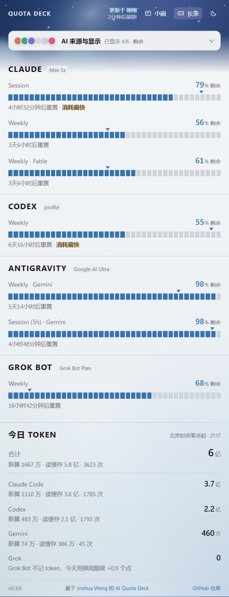
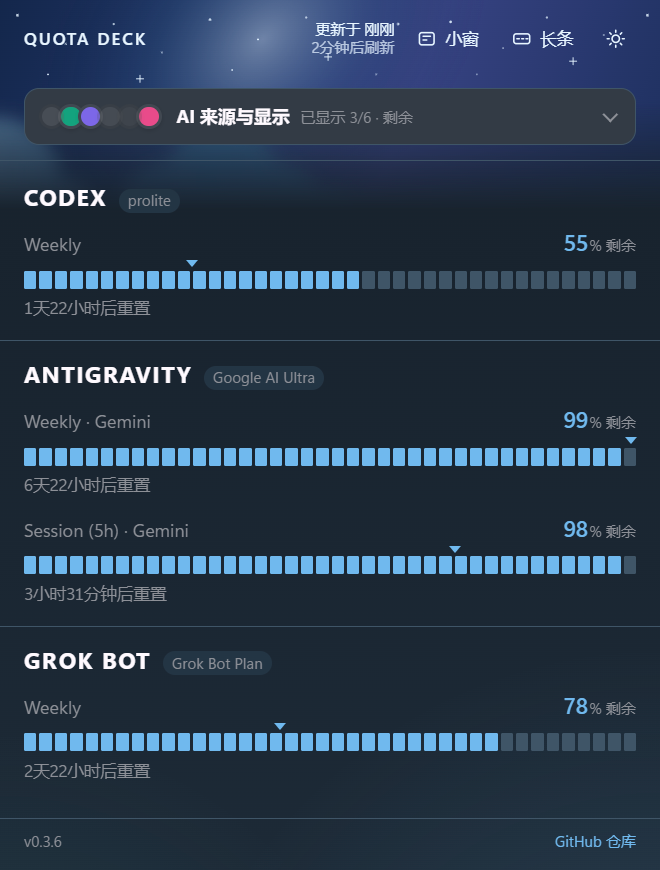
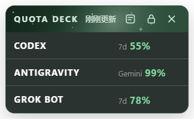
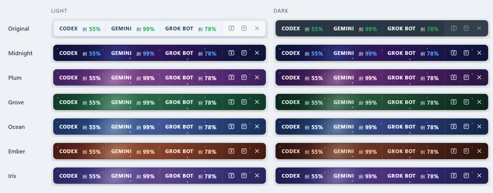

# 📊 AI Quota Deck

Codex、Antigravity、Claude Code、Gemini、Grok、Grok Bot の利用枠があとどれだけ残っていて、いつリセットされるのかをひと目で確認できる、Windows のタスクトレイ用ダッシュボードです。

[English](./README.md) | [简体中文](./README.zh-CN.md) | **日本語**

> このリポジトリは [JoshuaWang2211/ai-quota-deck](https://github.com/JoshuaWang2211/ai-quota-deck) のフォークです。各サービスの利用枠の取得、トレイアプリ、ブラウザブリッジは Joshua Wang 氏の成果で、このフォークでは画面まわりを作り直しています。
>
> **画面の表示は簡体字中国語です。** 英語の画面を使いたい場合は、[オリジナル版のリリース](https://github.com/JoshuaWang2211/ai-quota-deck/releases/latest)をご利用ください。

---

## スクリーンショット

### ダッシュボード
<p align="center">
  
  
</p>

### ウィジェット
<p align="center">
  
</p>

### ストリップ
<p align="center">
  
</p>

### パレット
<p align="center">
  
</p>

---

## このフォークでの変更点

- **簡体字中国語の画面。** Weekly や 5-hour といった利用枠の名前と、各サービス名は英語のままです。
- **目盛り式のメーター。** 各利用枠を 40 個の目盛りで表示します。小さな三角形はペースの目安で、期間内に均等に使った場合に今どこまで使っているはずかを示します。
- **7 種類のパレット。** オリジナルの配色に加えて、Midnight、Plum、Grove、Ocean、Ember、Iris を選べます。それぞれライトとダークがあり、新しい 6 種類には星空のヘッダーとやわらかなグラデーションが付きます。**AI 来源与显示**（AI ソースと表示）から切り替えます。
- **見やすくなったストリップ。** サービス名を省略せずに表示し、その後に「剩」（残り）または「已用」（使用済み）とパーセンテージを並べます。リセットまでの時間はマウスを乗せたときのツールチップに移し、ストリップを短く保っています。
- **ストリップを画面上部へ。** ストリップの最初のボタンを押すと、画面上部の中央に移動します。以前の「タスクバーの上に固定」ボタンを置き換えたものです。
- **Antigravity 2.34 以降に対応。** 新しい Antigravity は接続情報を `~/.gemini/antigravity/daemon/` に書き出すため、そこから読み取るようにしました。Antigravity のカードには Gemini の利用枠だけを表示します。

---

## 表示できるもの

| サービス | 利用枠 | 準備 |
|---|---|---|
| **Claude** | 5 時間、週ごと、利用可能な場合はモデル別の上限 | Claude Code にサインイン |
| **Codex** | アカウントに応じて月ごと（Free）または週ごと（Plus） | Codex デスクトップ版にサインイン |
| **Antigravity** | Gemini グループの週ごとと 5 時間の上限 | Antigravity IDE を開いておく |
| **Gemini** | 5 時間と週ごと | [上級者向け：ブラウザブリッジの設定](#上級者向けgemini-と-grok) |
| **Grok** | 週ごとの利用枠と製品別の内訳。無料アカウントではクエリ回数 | ブラウザブリッジ、または Grok Build CLI |
| **Grok Bot** | 独立した週ごとの利用枠 | Grok Bot デスクトップ版にサインイン |

設定されていないサービスは自動で非表示になり、それ以外のサービスも **AI 来源与显示** から隠せます。非表示のサービスには一切問い合わせません。各サービスは個別に更新されるので、どれかが失敗しても他には影響しません。

オリジナル版から引き継いでいる機能：

- ダッシュボード、ウィジェット、ストリップの 3 つの表示
- すべての表示で「使用済み」と「残り」を切り替え可能
- 常に最前面に表示されるウィジェット（位置を記憶し、固定もできます）
- ライト、ダーク、システム設定に合わせるテーマ
- トレイメニューと、任意のスタートアップ起動（**开机自启动**）
- サービスやブラウザに一時的に接続できないときは前回の値を表示
- Windows がアイドル状態またはロック中は Claude Code への問い合わせを停止し、期限切れのログインは公式 CLI で復旧し、レート制限時は安全に間隔を空けます

---

## インストール

**Windows 10 または 11 が必要です。** このフォークにはビルド済みのインストーラーがないため、ソースからビルドしてください。

1. [Windows 向けの Tauri の前提条件](https://v2.tauri.app/start/prerequisites/)をインストールします：Microsoft C++ Build Tools、WebView2（Windows 11 には標準搭載）、Rust、Node.js。
2. インストーラーをビルドします：

   ```powershell
   git clone https://github.com/dudu2099/ai-quota-deck.git
   cd ai-quota-deck
   npm install
   npx tauri build --bundles nsis
   ```

3. `src-tauri\target\release\bundle\nsis\` にあるインストーラーを実行し、**AI Quota Deck** を起動します。
4. ウィンドウを閉じるとタスクトレイに戻ります。トレイアイコンを左クリックすると再び開きます。

**Codex：** Codex デスクトップ版にサインインします。

**Claude：** Claude Code が検出されない場合は、インストールしてからターミナルで `claude` を一度実行し、サインインを済ませてください。その後 CLI を開いたままにしておく必要はありません。

**Antigravity：** Antigravity IDE に一度サインインし、最新の数値を見たいあいだは開いたままにしておきます。ダッシュボードは IDE が `127.0.0.1` で動かしているローカルサーバーから読み取ります。IDE を閉じているあいだは、前回の値がキャッシュとして最大 24 時間表示され、その後は IDE を開くよう案内が出ます。

**Grok Bot：** [Grok Bot デスクトップ版](https://docs.x.ai/grok-bot/get-started)をインストールし、一度サインインします。週ごとの利用枠は Grok/SuperGrok とは別にカウントされます。ダッシュボードは Grok Bot の短期アクセストークンだけを再利用し、期限が切れたらアプリを開き直すよう案内します。

---

## ウィジェットとストリップ

ダッシュボード上部の 2 つのボタンを使います：

- **小窗**（ウィジェット）は、常に最前面に表示される小さな画面です。ヘッダーをドラッグして配置し、鍵のボタンで位置を固定・解除します。
- **长条**（ストリップ）は、同じ数値を横長のバーにまとめます。ボタン以外の部分をドラッグすると自由に配置でき、最初のボタンを押すと画面上部の中央に移動します。Windows の作業領域を占有したり縮めたりはしません。

ウィジェットとストリップはそれぞれ別の位置を記憶します。各画面のボタンやトレイメニューから、ダッシュボードを開いたり各画面を隠したりできます。どちらもダッシュボードの値を共有するので、余計な問い合わせは発生しません。

---

## 上級者向け：Gemini と Grok

> この設定は少し手間がかかります。Chromium の開発者モード、手動で読み込む展開済み拡張機能、サインイン済みの Gemini または Grok のタブが必要です。

Gemini と Grok の利用状況は、同梱の **AI Quota Deck Browser Bridge** を通じてブラウザのタブから読み取ります。Claude Code、Codex、Antigravity、Grok Bot だけを使う場合は、このセクションは飛ばしてかまいません。

- Gemini にはブリッジが必須です。
- Grok はブリッジを優先しますが、サインイン済みの Grok Build CLI で代用することもできます。
- 動作確認済みのブラウザ：Chrome、Comet、Edge、Brave。Vivaldi、Opera、Chromium は登録済みですが、まだ確認していません。

### 設定

1. AI Quota Deck を一度起動し、ダッシュボード上部の **AI 来源与显示** を開きます。
2. アプリに表示されるブリッジのフォルダーをコピーするか開きます：

   ```text
   %LOCALAPPDATA%\ai-quota-deck\browser-bridge
   ```

3. `chrome://extensions` を開き、**デベロッパー モード** をオンにして **パッケージ化されていない拡張機能を読み込む** を選びます。
4. ブリッジのフォルダーを選択します。
5. ツールバーのブリッジのアイコンを一度クリックし、デスクトップアプリとの通信を許可します。
6. サインイン済みの [Gemini](https://gemini.google.com) または [Grok](https://grok.com) のタブを開いておきます。

通常は 3 分ほどで、またはダッシュボードを前面に出したときにカードが表示されます。

### 使い続けるために

新しい値を取得するには、ブリッジとサインイン済みのタブが使える状態である必要があります。タブはバックグラウンドでもかまいませんが、ブラウザやタブを閉じている、アカウントからサインアウトしている、PC がスリープしている場合は更新できません。そのあいだは前回の値をキャッシュとして表示し、復帰やロック解除のあとに新しい値を取りにいきます。

AI Quota Deck を更新したら、ブリッジのファイルを読み込み直すためにブラウザを再起動してください。

---

## トラブルシューティング

**Gemini や Grok が表示されない：** ブリッジが有効になっているか確認し、ツールバーのアイコンを一度クリックしてから、サインイン済みのタブを開いてください。

**ブラウザのデータが古いまま：** 対応するタブを開き、最大 3 分ほど待ってください。ブラウザ、ブリッジ、タブ、トレイアプリがすべて動いている必要があります。

**Claude がレート制限された：** キャッシュされたカードにカウントダウンが表示されます。サーバーが指定する待機時間は再起動をまたいでも守られます。Claude Code にサインインし直すと、古いサインインに結びついた待機時間は解除されます。

**アイドル中やロック中に Claude が更新されない：** 意図した動作です。復帰後、Claude デスクトップ版や Claude Code と同時に動かないよう、約 2 分待ってから確認します。すでにレート制限の待機中であれば、そちらが優先されます。

**Claude のトークンが拒否された：** インストール済みの Claude Code CLI にバックグラウンドでトークンを更新させ、自動で再試行します。それでも失敗する場合は、Claude Code を一度開いてください。

**Antigravity で IDE を開くよう案内される：** Antigravity の値は IDE が起動しているあいだしか読み取れません。IDE を起動し、1 回分の更新を待ってください。

**Grok Bot で再サインインを求められる：** Grok Bot を一度開いてください。ダッシュボードが自分でアカウントを更新することはありません。次の確認時に、更新された短期アクセストークンを読み取ります。

**Windows に「不明な発行元」と表示される：** ビルドしたアプリにはコード署名がありません。

---

## プライバシー

AI Quota Deck にはテレメトリーがなく、何もアップロードしません。

- 各デスクトップアプリや CLI にすでに保存されているサインイン情報だけを使います。
- 各サービスのリフレッシュトークンを読み取ったり使ったりすることはありません。Claude が `401` を返した場合は、公式の `claude update` コマンドをバックグラウンドで実行し、Claude Code のアクセストークンを読み直します。このコマンドによって Claude Code 自体が更新されることがあります。
- Antigravity は、IDE がこの PC に書き出す接続情報を使い、`127.0.0.1` 上のローカルサーバーからのみ読み取ります。Google のサインイン情報を読み取ったり、保存したり、更新したりすることはありません。
- Chromium 方式で暗号化された Grok Bot のローカルアクセストークンは、利用状況を問い合わせるときだけ Windows DPAPI で復号します。リフレッシュトークンを解析、復号、使用、キャッシュ、送信することは一切ありません。
- ブリッジが読み取れるのは `gemini.google.com` と `grok.com` だけです。
- アプリに届くのは、利用枠の値、リセット時刻、サービスとアカウントの区別、取得時刻だけです。Cookie やページ内のトークンはブラウザの外に出ません。

---

## 制限事項

これらのサービスの利用状況は、公開されていない内部エンドポイントから取得しています。レスポンスの形式が変わると、そのサービスのカードが動かなくなることがありますが、他のサービスはそれぞれ動き続けます。

同じブラウザのサービスに複数のアカウントでサインインしている場合は、最後に報告されたアカウントが表示されます。アカウントの指定にはまだ対応していません。

---

## クレジット

- オリジナル：[AI Quota Deck](https://github.com/JoshuaWang2211/ai-quota-deck)（作者：[Joshua Wang](https://www.threads.com/@joshuawang2211)）。各サービスの取得まわりの問題はオリジナルのリポジトリへお寄せください。
- Gemini や Grok だけを確認したい場合は、Joshua Wang 氏による単体の Chrome 拡張機能もあります：[Gemini Usage Monitor](https://chromewebstore.google.com/detail/cdepnbhodggenlkdeelnocfckdendhad)、[Grok Usage Watch](https://chromewebstore.google.com/detail/bmpboaihdkpkjehbceegdmndkonlpdge)。
- [変更履歴](./docs/CHANGELOG.md) · [アーキテクチャのメモ](./docs/ARCHITECTURE.md)

## ライセンス

[MIT ライセンス](./LICENSE)で公開しています。
