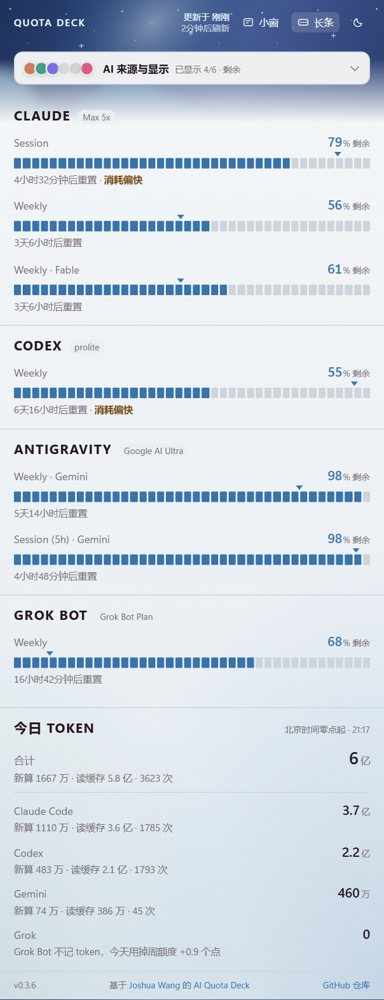
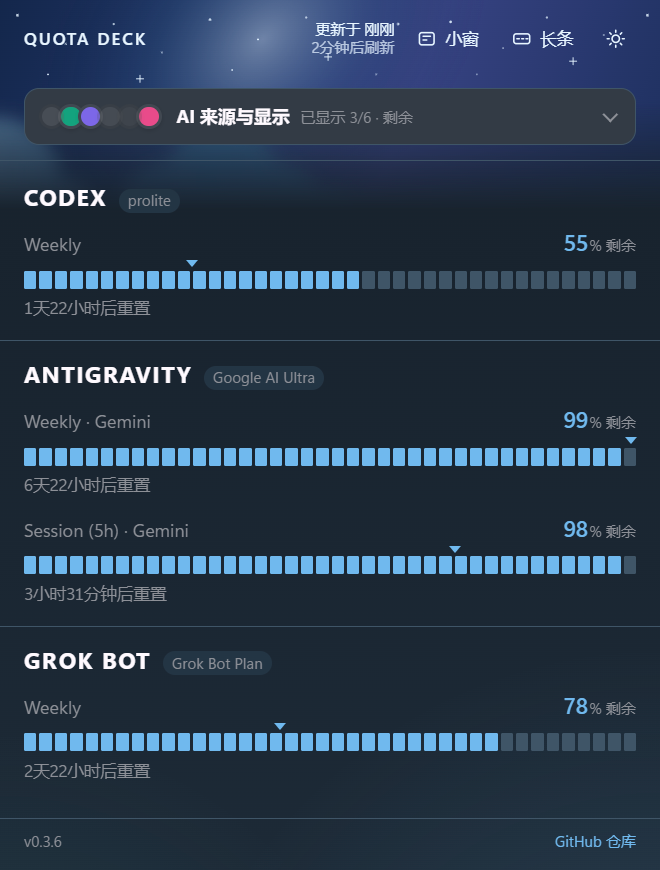
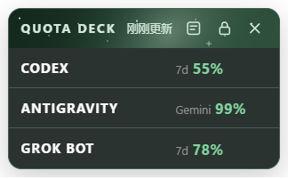
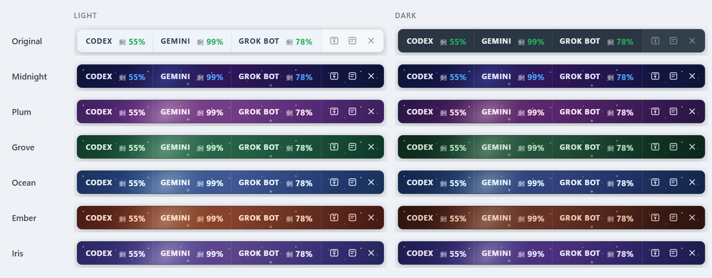

# 📊 AI Quota Deck

A Windows tray dashboard that shows how much of each AI allowance is left and when it resets — Codex, Antigravity, Claude Code, Gemini, Grok, and Grok Bot.

**English** | [简体中文](./README.zh-CN.md) | [日本語](./README.ja.md)

> Built on [AI Quota Deck](https://github.com/JoshuaWang2211/ai-quota-deck) by Joshua Wang, whose work reads each provider's quota and runs the tray app and the browser bridge. This fork improves on it in many ways: a reworked interface, seven palettes, a clearer strip, and support for newer Antigravity versions.
>
> **The interface is in Simplified Chinese.** For the original English interface, use the [upstream release](https://github.com/JoshuaWang2211/ai-quota-deck/releases/latest).

---

## Screenshots

### Dashboard
<p align="center">
  
  
</p>

### Widget
<p align="center">
  
</p>

### Strip
<p align="center">
  
</p>

### Palettes
<p align="center">
  
</p>

---

## What this fork changes

- **Simplified Chinese interface.** Window names such as Weekly and 5-hour, and the provider names, stay in English.
- **Tick meters.** Each allowance is drawn as 40 ticks. A small triangle marks the pace: where usage would be if it were spread evenly across the window.
- **Seven palettes.** The original look plus Midnight, Plum, Grove, Ocean, Ember, and Iris, each in light and dark. The six new palettes add a starry night-sky header and soft gradients. Choose one under **AI 来源与显示** (AI sources & display).
- **A clearer strip.** Full provider names, then 剩 (left) or 已用 (used) and the percentage. The reset countdown moved into the hover tooltip to keep the strip short.
- **Move the strip to the top.** The strip's first button moves it to the top centre of the screen. It replaces the pin-above-the-taskbar button.
- **Antigravity 2.34 and later.** Newer Antigravity versions write their connection details to `~/.gemini/antigravity/daemon/`; the deck now reads them there. The Antigravity card shows only the Gemini allowance.

---

## What it shows

| Provider | Usage windows | Setup |
|---|---|---|
| **Claude** | 5-hour, weekly, and model-specific limits when available | Sign in to Claude Code |
| **Codex** | Monthly (Free) or weekly (Plus), depending on the account | Sign in to Codex Desktop |
| **Antigravity** | Weekly and 5-hour limits for the Gemini pool | Keep Antigravity IDE open |
| **Gemini** | 5-hour and weekly | [Advanced Browser Bridge setup](#advanced-gemini-and-grok) |
| **Grok** | Weekly and product breakdown; free query limits when applicable | Browser Bridge, or Grok Build fallback |
| **Grok Bot** | Independent weekly allowance | Sign in to the Grok Bot desktop app |

Providers that are not configured stay hidden, and you can hide any of the others under **AI 来源与显示**; hidden providers are not polled at all. Each provider refreshes independently, so one failure does not block the others.

Also included from the original:

- Dashboard, Widget, and Strip views
- Percentages shown as used or remaining allowance, across every view
- Always-on-top widget with a remembered, lockable position
- Light, dark, and system themes
- Tray menu and optional launch at startup (**开机自启动**)
- Cached readings when a provider or browser is temporarily unavailable
- Claude Code polling pauses while Windows is idle or locked, recovers expired OAuth sessions through the official CLI, and backs off safely after rate limits

---

## Installation

**Requires Windows 10 or 11.** This fork has no prebuilt installer; build it from source.

1. Install the [Tauri prerequisites for Windows](https://v2.tauri.app/start/prerequisites/): Microsoft C++ Build Tools, WebView2 (already on Windows 11), Rust, and Node.js.
2. Build the installer:

   ```powershell
   git clone https://github.com/dudu2099/ai-quota-deck.git
   cd ai-quota-deck
   npm install
   npx tauri build --bundles nsis
   ```

3. Run the installer from `src-tauri\target\release\bundle\nsis\`, then launch **AI Quota Deck**.
4. Close the window to return it to the system tray; left-click the tray icon to reopen it.

**Codex:** sign in to Codex Desktop.

**Claude:** if Claude Code is not detected, install it, run `claude` once in a terminal, and complete sign-in. The CLI does not need to remain open.

**Antigravity:** sign in to Antigravity IDE once and keep it open while you want live numbers. The deck reads the IDE's local language server on `127.0.0.1`; while the IDE is closed the last reading stays visible as cached for up to 24 hours, then the card asks you to open the IDE.

**Grok Bot:** install the [Grok Bot desktop app](https://docs.x.ai/grok-bot/get-started) and sign in once. Its weekly allowance is separate from Grok/SuperGrok usage. The deck reuses only Grok Bot's short-lived access token and asks you to reopen the app when that token expires.

---

## Widget and Strip

Use the two buttons at the top of the dashboard:

- **小窗** (Widget) opens a small always-on-top view. Drag its header to place it; the lock button locks or unlocks that position.
- **长条** (Strip) arranges the same values in a compact horizontal bar. Drag anywhere outside its buttons to place it freely, or press its first button to move it to the top centre of the screen. It does not reserve or reduce the Windows work area.

Widget and Strip remember separate positions. Open the dashboard or hide either view with its controls or the tray menu. Both reuse the dashboard's readings and make no additional provider requests.

---

## Advanced: Gemini and Grok

> This setup is more involved. It requires Chromium Developer mode, a manually loaded unpacked extension, and a signed-in Gemini or Grok tab.

Gemini and Grok usage is read from a browser tab through the bundled **AI Quota Deck Browser Bridge**. Skip this section if you only use Claude Code, Codex, Antigravity, or Grok Bot.

- Gemini requires the bridge.
- Grok prefers the bridge but can fall back to a signed-in Grok Build CLI.
- Verified browsers: Chrome, Comet, Edge, and Brave. Vivaldi, Opera, and Chromium are registered but not yet verified.

### Setup

1. Launch AI Quota Deck once and open **AI 来源与显示** near the top of the dashboard.
2. Copy or open the bridge folder shown by the app:

   ```text
   %LOCALAPPDATA%\ai-quota-deck\browser-bridge
   ```

3. Open `chrome://extensions`, enable **Developer mode**, and choose **Load unpacked**.
4. Select the bridge folder.
5. Click the bridge toolbar icon once to grant desktop communication permission.
6. Keep a signed-in [Gemini](https://gemini.google.com) or [Grok](https://grok.com) tab open.

The card normally appears within about three minutes or when the deck is brought to the front.

### Keep it installed

The bridge and a matching signed-in tab must remain available for fresh readings. Background tabs are fine, but the bridge cannot update while the browser or tab is closed, the account is signed out, or the computer is asleep. The deck keeps the last reading as cached and requests a new one after wake or unlock.

After updating AI Quota Deck, restart the browser so it reloads the bundled bridge files.

---

## Troubleshooting

**Gemini or Grok is missing:** confirm the bridge is enabled, click its toolbar icon once, and open a signed-in provider tab.

**Browser data is stale:** open the matching tab and allow up to three minutes. The browser, bridge, tab, and tray app must all be running.

**Claude is rate limited:** the cached card shows the countdown. The deck honors the full server cooldown across restarts; new Claude Code credentials clear a deadline tied to the old sign-in.

**Claude did not update while idle or locked:** this is intentional. After you return, the app waits about two minutes before checking so it does not race Claude Desktop or Claude Code during wake-up. An existing rate-limit cooldown still takes priority.

**Claude reports a rejected token:** the deck asks the installed Claude Code CLI to refresh it in the background, then retries automatically. If that fails, open Claude Code once.

**Antigravity asks you to open the IDE:** the deck can only read Antigravity while the IDE is running. Start it and allow one refresh cycle.

**Grok Bot asks you to sign in again:** open Grok Bot once. The deck never refreshes the account itself; it will pick up the renewed short-lived access token on the next check.

**Windows reports an unknown publisher:** builds are not code-signed.

---

## Privacy

AI Quota Deck has no telemetry and uploads nothing.

- It uses sign-ins already stored by the supported desktop or CLI clients.
- It never reads or uses provider refresh tokens. After a Claude `401`, it runs the official `claude update` command in the background and rereads Claude Code's access token; this command may also update Claude Code itself.
- Antigravity is read from the IDE's local language server on `127.0.0.1` only, using the connection details the IDE writes on this computer. The deck never reads, stores, or refreshes a Google sign-in.
- Grok Bot's Chromium-encrypted local access token is unlocked with Windows DPAPI only for the live usage request. Its refresh token is never deserialized, decrypted, used, cached, or sent anywhere by the deck.
- The bridge can read only `gemini.google.com` and `grok.com`.
- Only quota values, reset times, provider/account slots, and observation times reach the app. Cookies and page tokens stay in the browser.

---

## Limitations

These providers expose usage through undocumented internal endpoints. A provider card may stop working when its response format changes; the other providers continue independently.

If the same browser provider is signed in with multiple accounts, the most recently reported account is shown. Account pinning is not implemented yet.

---

## Credits

- Original project: [AI Quota Deck](https://github.com/JoshuaWang2211/ai-quota-deck) by [Joshua Wang](https://www.threads.com/@joshuawang2211). Issues with the provider integrations belong there.
- Joshua Wang also makes standalone Chrome extensions if you only need Gemini or Grok: [Gemini Usage Monitor](https://chromewebstore.google.com/detail/cdepnbhodggenlkdeelnocfckdendhad) and [Grok Usage Watch](https://chromewebstore.google.com/detail/bmpboaihdkpkjehbceegdmndkonlpdge).
- [Changelog](./docs/CHANGELOG.md) · [Architecture notes](./docs/ARCHITECTURE.md)

## License

Licensed under the [MIT License](./LICENSE).
