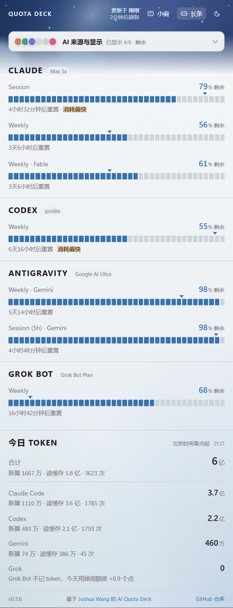
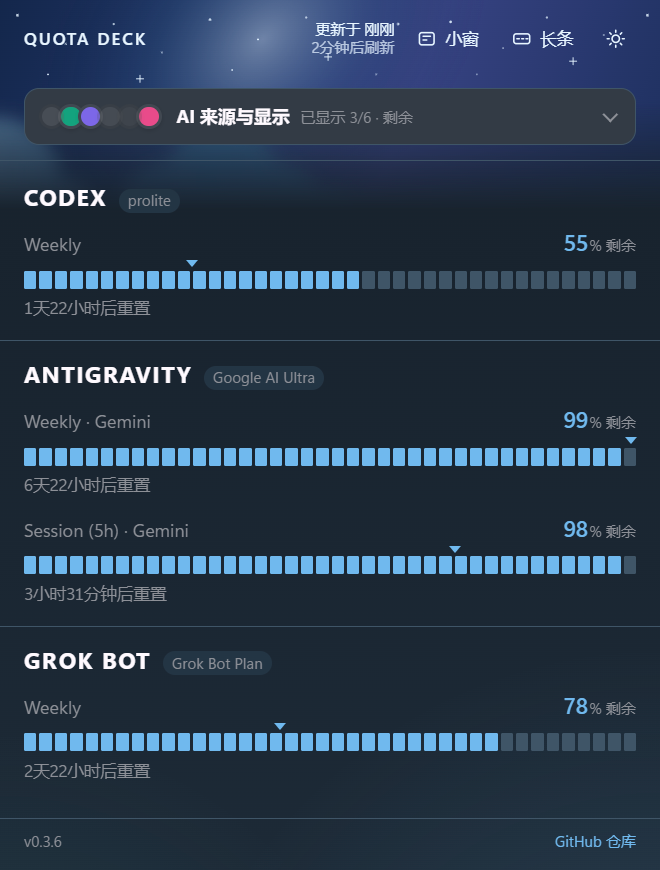
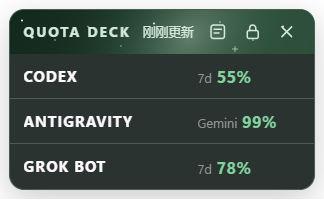
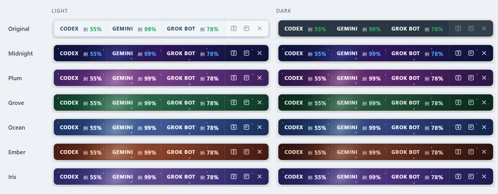

# 📊 AI Quota Deck

Windows 托盘里的 AI 额度看板：Codex、Antigravity、Claude Code、Gemini、Grok、Grok Bot 各还剩多少、什么时候重置，一眼看清。

[English](./README.md) | **简体中文** | [日本語](./README.ja.md)

> 本项目分叉自 [JoshuaWang2211/ai-quota-deck](https://github.com/JoshuaWang2211/ai-quota-deck)。各家额度的读取、托盘程序和浏览器桥都是 Joshua Wang 的作品，这个分叉改的是界面。
>
> **界面是简体中文。** 想用原版英文界面，请下载[原项目的安装包](https://github.com/JoshuaWang2211/ai-quota-deck/releases/latest)。

---

## 截图

### 主面板
<p align="center">
  
  
</p>

### 小窗
<p align="center">
  
</p>

### 长条
<p align="center">
  
</p>

### 配色
<p align="center">
  
</p>

---

## 这个分叉改了什么

- **简体中文界面。** Weekly、5-hour 这类额度窗口的名字和各家服务名保留英文。
- **刻度条。** 每项额度画成 40 格，上面的小三角是节奏线：假如在这个周期里匀速用，此刻应该用到哪里。
- **七套配色。** 原版加上 Midnight、Plum、Grove、Ocean、Ember、Iris，每套都有浅色和深色。新加的六套顶部是一片星空，底色带柔和的渐变。在 **AI 来源与显示** 里切换。
- **长条更好懂。** 写全服务名，后面跟「剩」或「已用」和百分比。重置倒计时挪进了鼠标悬停提示，长条不再拉得老长。
- **长条一键到顶。** 长条的第一个按钮把它移到屏幕顶部正中，取代了原来「停到任务栏上」的按钮。
- **支持 Antigravity 2.34 及以后。** 新版 Antigravity 把连接信息写在 `~/.gemini/antigravity/daemon/` 里，现在从那里读。Antigravity 卡片只显示 Gemini 那一组额度。

---

## 能看什么

| 服务 | 额度窗口 | 准备 |
|---|---|---|
| **Claude** | 5 小时、每周，有的话还有按模型的额度 | 登录 Claude Code |
| **Codex** | 按账号不同，每月（Free）或每周（Plus） | 登录 Codex 桌面版 |
| **Antigravity** | Gemini 那一组的每周和 5 小时额度 | 开着 Antigravity IDE |
| **Gemini** | 5 小时和每周 | [进阶：浏览器桥](#进阶gemini-和-grok) |
| **Grok** | 每周额度和按产品的细分；免费账号显示查询次数 | 浏览器桥，或退而用 Grok Build 命令行 |
| **Grok Bot** | 单独的每周额度 | 登录 Grok Bot 桌面版 |

没配好的服务自动隐藏，其余的也可以在 **AI 来源与显示** 里藏起来；藏起来的服务完全不去查。每家各自刷新，一家出错不影响别家。

原版就有的功能：

- 主面板、小窗、长条三种视图
- 所有视图都能切换显示「已用」或「剩余」
- 小窗始终置顶，位置记得住，也能锁定
- 浅色、深色、跟随系统
- 托盘菜单，可选开机自启动
- 某家或浏览器暂时连不上时，显示上次的读数
- Windows 空闲或锁屏时暂停查询 Claude Code；登录过期时通过官方命令行恢复；碰到限流会安全地退避

---

## 安装

**需要 Windows 10 或 11。** 这个分叉没有现成的安装包，要从源码编译。

1. 装好 [Tauri 在 Windows 上的依赖](https://v2.tauri.app/start/prerequisites/)：Microsoft C++ 生成工具、WebView2（Windows 11 自带）、Rust、Node.js。
2. 编译安装包：

   ```powershell
   git clone https://github.com/dudu2099/ai-quota-deck.git
   cd ai-quota-deck
   npm install
   npx tauri build --bundles nsis
   ```

3. 运行 `src-tauri\target\release\bundle\nsis\` 里的安装包，然后打开 **AI Quota Deck**。
4. 关掉窗口它会缩回托盘，左键点托盘图标重新打开。

**Codex：** 登录 Codex 桌面版。

**Claude：** 没检测到 Claude Code 的话，先装上，在终端里运行一次 `claude` 并登录。之后命令行不用一直开着。

**Antigravity：** 登录一次 Antigravity IDE，想看实时数字就让它开着。看板读的是 IDE 在 `127.0.0.1` 上的本地服务；IDE 关着的时候，上次的读数会作为缓存显示，最多 24 小时，之后卡片会提示你打开 IDE。

**Grok Bot：** 装好 [Grok Bot 桌面版](https://docs.x.ai/grok-bot/get-started) 并登录一次。它的每周额度和 Grok/SuperGrok 是分开算的。看板只借用 Grok Bot 的短期访问令牌，令牌过期时会提示你重新打开它。

---

## 小窗和长条

主面板顶上有两个按钮：

- **小窗**：一个始终置顶的小视图。拖标题栏摆位置，锁形按钮锁定或解锁位置。
- **长条**：把同样的数字排成一条横栏。按住按钮以外的地方随意拖，或者点它的第一个按钮移到屏幕顶部正中。它不占用、也不压缩 Windows 的工作区。

小窗和长条各记各的位置。用它们自己的按钮或托盘菜单打开主面板、隐藏视图。两者都复用主面板的读数，不会额外去查。

---

## 进阶：Gemini 和 Grok

> 这一步比较折腾：要打开 Chromium 的开发者模式、手动加载解压的扩展，还要开着一个已登录的 Gemini 或 Grok 标签页。

Gemini 和 Grok 的用量是通过自带的 **AI Quota Deck Browser Bridge** 从浏览器标签页里读的。只用 Claude Code、Codex、Antigravity 或 Grok Bot 的话，跳过这一节。

- Gemini 必须用浏览器桥。
- Grok 优先用浏览器桥，也可以退而用已登录的 Grok Build 命令行。
- 验证过的浏览器：Chrome、Comet、Edge、Brave。Vivaldi、Opera、Chromium 已注册但还没验证。

### 设置

1. 先打开一次 AI Quota Deck，展开主面板顶部的 **AI 来源与显示**。
2. 复制或打开程序显示的浏览器桥文件夹：

   ```text
   %LOCALAPPDATA%\ai-quota-deck\browser-bridge
   ```

3. 打开 `chrome://extensions`，开启 **开发者模式**，选 **加载已解压的扩展程序**。
4. 选中浏览器桥文件夹。
5. 点一次工具栏上的浏览器桥图标，允许它和桌面程序通信。
6. 开着一个已登录的 [Gemini](https://gemini.google.com) 或 [Grok](https://grok.com) 标签页。

卡片一般在三分钟内出现，或者在你把看板切到前台时出现。

### 保持可用

要拿到新读数，浏览器桥和对应的已登录标签页得一直在。标签页放在后台没问题；但浏览器或标签页关了、账号退出了、电脑睡眠了，浏览器桥就没法更新。看板会把上次的读数作为缓存留着，唤醒或解锁后再去要新的。

更新 AI Quota Deck 之后，重启一次浏览器，让它重新加载浏览器桥的文件。

---

## 排错

**Gemini 或 Grok 没出现：** 确认浏览器桥已启用，点一次它的工具栏图标，再打开一个已登录的标签页。

**浏览器的数据不更新：** 打开对应的标签页，最多等三分钟。浏览器、浏览器桥、标签页、托盘程序都得开着。

**Claude 被限流：** 缓存的卡片上会显示倒计时。看板会守满服务器给的冷却时间，重启也一样；重新登录 Claude Code 后，绑在旧登录上的冷却会清掉。

**空闲或锁屏时 Claude 没更新：** 这是故意的。你回来后程序会等大约两分钟再查，免得在唤醒时和 Claude 桌面版、Claude Code 抢。已有的限流冷却仍然优先。

**Claude 提示令牌被拒：** 看板会让本机的 Claude Code 命令行在后台刷新令牌，然后自动重试。还不行的话，打开一次 Claude Code。

**Antigravity 提示打开 IDE：** 只有 IDE 开着时才读得到 Antigravity。打开它，等一个刷新周期。

**Grok Bot 提示重新登录：** 打开一次 Grok Bot。看板从不自己刷新账号，下次查询时会读到续期后的短期令牌。

**Windows 提示未知发布者：** 编译出来的程序没有代码签名。

---

## 隐私

AI Quota Deck 没有遥测，什么都不上传。

- 只用各家桌面端或命令行已经存好的登录信息。
- 从不读取、使用各家的刷新令牌。Claude 返回 `401` 后，它在后台运行官方的 `claude update` 命令，再重新读 Claude Code 的访问令牌；这个命令可能顺带更新 Claude Code 本身。
- Antigravity 只从 IDE 在 `127.0.0.1` 上的本地服务读取，用的是 IDE 写在本机的连接信息。看板从不读取、保存或刷新 Google 登录。
- Grok Bot 在本地经过 Chromium 加密的访问令牌，只在实时查询用量时用 Windows DPAPI 解开。它的刷新令牌看板从不解析、解密、使用、缓存或外传。
- 浏览器桥只能读 `gemini.google.com` 和 `grok.com`。
- 到达程序的只有额度数值、重置时间、服务和账号位置、读取时间。Cookie 和页面令牌留在浏览器里。

---

## 局限

这些服务的用量是通过没有公开文档的内部接口拿的。哪家的返回格式一变，那张卡片就可能失灵；别家照常工作。

同一个浏览器服务登录了多个账号时，显示最近上报的那个。还不能指定账号。

---

## 致谢

- 原项目：[AI Quota Deck](https://github.com/JoshuaWang2211/ai-quota-deck)，作者 [Joshua Wang](https://www.threads.com/@joshuawang2211)。各家额度读取方面的问题请到原项目反馈。
- 只想看 Gemini 或 Grok 的话，Joshua Wang 还做了两个独立的 Chrome 扩展：[Gemini Usage Monitor](https://chromewebstore.google.com/detail/cdepnbhodggenlkdeelnocfckdendhad) 和 [Grok Usage Watch](https://chromewebstore.google.com/detail/bmpboaihdkpkjehbceegdmndkonlpdge)。
- [更新日志](./docs/CHANGELOG.md) · [架构说明](./docs/ARCHITECTURE.md)

## 许可证

采用 [MIT 许可证](./LICENSE)。
